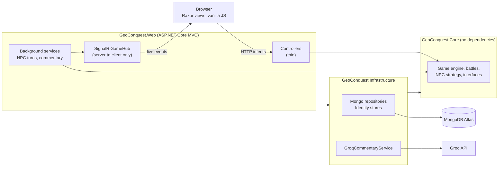
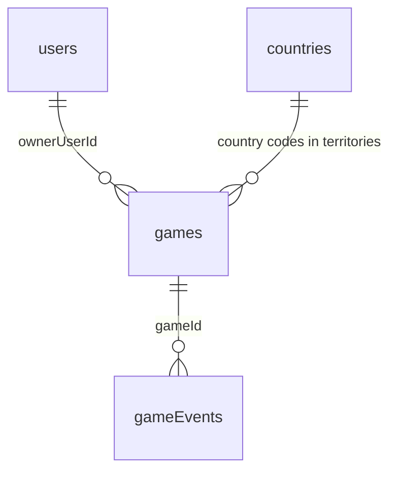

# GeoConquest

GeoConquest is a single-player, Risk-style geopolitics game for the browser. You pick a country, and nine other
countries are chosen at random and played by the computer (NPCs). Each country has soldiers based on its population.
You reinforce, move soldiers, and attack with dice until you own all ten countries or lose yours. All rules and dice run
on the server. Anyone with the game link can watch a game live. Built with ASP.NET Core MVC (.NET 10), SignalR and
MongoDB Atlas for the UCT INF4001 Honours entrance exam.


Demo video: (link added at submission)

## Quick start for markers

- **Deployed app:** (URL added at submission)
- **Demo account email:** (added at submission)
- **Demo account password:** (added at submission)

The first request after a quiet period can take about a minute while the free host wakes up.
Tip: start a campaign with a large country such as India or China. NPCs attack hard, and big countries start with more
soldiers.

### Run it locally

You need the .NET 10 SDK and a MongoDB Atlas cluster (the free M0 tier is enough).

```
dotnet user-secrets set "MongoDb:ConnectionString" "<your Atlas connection string>" --project src/GeoConquest.Web
dotnet user-secrets set "Groq:ApiKey" "<optional Groq API key>" --project src/GeoConquest.Web
dotnet run --project src/GeoConquest.Web
```

Then open the address printed in the console. The Groq key is optional; without it the commentary comes from templates.
On first start the app creates its indexes and loads the 234 countries from
[countries.json](src/GeoConquest.Infrastructure/Seed/countries.json). To check the code, run `dotnet build` and
`dotnet test`.

## Screenshots

| | |
|---|---|
| Landing page |  |
| Board on a desktop |  |
| Board on a phone |  |
| A spectator's view |  |
| Game over |  |

## Marker's Guide

Every rubric row, with the files and tests that are the evidence. Paths start at the repository root.

| # | Rubric row | Where to look | Tests |
|---|---|---|---|
| 1 | Database layer | `src/GeoConquest.Infrastructure/` is a separate project holding all MongoDB code: `src/GeoConquest.Infrastructure/Repositories/`, `src/GeoConquest.Infrastructure/Data/MongoContext.cs`, `src/GeoConquest.Infrastructure/Configuration/MongoDbOptions.cs`. Core only sees interfaces such as `src/GeoConquest.Core/Interfaces/IGameRepository.cs`. | `tests/GeoConquest.Infrastructure.Tests/Data/MongoMappingTests.cs`, `tests/GeoConquest.Infrastructure.Tests/Seed/CountrySeederTests.cs` |
| 2 | Connection | One `IMongoClient` registered once in `src/GeoConquest.Infrastructure/DependencyInjection.cs`; connection string validated at start-up from secrets or environment; `/health` pings the database via `src/GeoConquest.Infrastructure/Data/MongoHealthCheck.cs`, mapped in `src/GeoConquest.Web/Program.cs`. | `tests/GeoConquest.Web.Tests/HealthEndpointTests.cs` |
| 3 | Database design | Collections, indexes and mapping: `src/GeoConquest.Infrastructure/Data/MongoContext.cs`, `src/GeoConquest.Infrastructure/Data/Mapping/MongoMappingConfiguration.cs`, `src/GeoConquest.Core/Models/Game.cs`. See [Database design](#database-design). | `tests/GeoConquest.Infrastructure.Tests/Data/MongoMappingTests.cs` |
| 4 | Coding structure | Three projects plus tests (see [Architecture](#architecture)). Services are registered in extension methods in `src/GeoConquest.Web/Extensions/`; settings are `IOptions` classes; controllers in `src/GeoConquest.Web/Controllers/` are thin. Conventions: `.editorconfig`, `Directory.Build.props`. | `tests/GeoConquest.Web.Tests/Fakes/GeoConquestWebFactory.cs` (every Web test starts the real application with its DI container, using in-memory repositories) |
| 5 | OOP | Models guard their own state: `src/GeoConquest.Core/Models/Territory.cs`, `src/GeoConquest.Core/Models/Game.cs`. Interfaces with several implementations: `src/GeoConquest.Core/Interfaces/ICommentaryService.cs` (template, Groq, resilient wrapper), `src/GeoConquest.Core/Interfaces/INpcStrategy.cs`, `src/GeoConquest.Core/Interfaces/IDiceRoller.cs`. Rule breaches throw `src/GeoConquest.Core/Exceptions/GameRuleException.cs`. | `tests/GeoConquest.Core.Tests/Models/TerritoryTests.cs`, `tests/GeoConquest.Core.Tests/Models/GameTests.cs` |
| 6 | Validation and security | Form validation: `src/GeoConquest.Web/ViewModels/RegisterViewModel.cs`, `src/GeoConquest.Web/ViewModels/AttackRequest.cs`. Domain guards in `src/GeoConquest.Core/Services/GameEngine.cs`. Error mapping: `src/GeoConquest.Web/Filters/GameErrorFilterAttribute.cs`. Anti-forgery, rate limiting: `src/GeoConquest.Web/Extensions/SecurityServiceCollectionExtensions.cs`. Dice: `src/GeoConquest.Core/Services/SecureDiceRoller.cs`. See [Security](#security). | `tests/GeoConquest.Web.Tests/AccountTests.cs` (password policy, anti-forgery, throttling), `tests/GeoConquest.Core.Tests/Services/GameEngineTests.cs` (rule guards), `tests/GeoConquest.Web.Tests/LiveUpdatesTests.cs` (no `innerHTML`) |
| 7 | Functionality | `src/GeoConquest.Core/Services/GameEngine.cs` (turn state machine), `BattleService.cs`, `ReinforcementService.cs`, `GameSetupService.cs`, `SoldierAllocator.cs` in `src/GeoConquest.Core/Services/`. | `tests/GeoConquest.Core.Tests/Services/GameEngineTests.cs`, `BattleServiceTests.cs`, `ReinforcementServiceTests.cs`, `GameSetupServiceTests.cs`, `SoldierAllocatorTests.cs` (same folder) |
| 8 | Lists, searching, filtering, viewing | My campaigns (search, status, sort): `src/GeoConquest.Web/Views/Games/Index.cshtml`. Live games (search): `src/GeoConquest.Web/Views/LiveGames/Index.cshtml`. Country picker with search: `src/GeoConquest.Web/Views/Games/New.cshtml`. Event log filter (all, battles, NPC decisions, commentary): `src/GeoConquest.Web/Views/Games/_EventLog.cshtml`. Logic: `src/GeoConquest.Core/Services/GameQueryService.cs`. | `tests/GeoConquest.Core.Tests/Services/GameApplicationServiceTests.cs`, `tests/GeoConquest.Web.Tests/GamesTests.cs` |
| 9 | User interface | Hand-written CSS with design tokens: `src/GeoConquest.Web/wwwroot/css/tokens.css`, `src/GeoConquest.Web/wwwroot/css/components/`, `src/GeoConquest.Web/wwwroot/css/pages/`. Self-hosted fonts: `src/GeoConquest.Web/wwwroot/fonts/`. Board: `src/GeoConquest.Web/Views/Games/Play.cshtml` and `src/GeoConquest.Web/wwwroot/js/board.js`. | `tests/GeoConquest.Web.Tests/PageShellTests.cs` |
| 10 | Ease of navigation | Layout and nav: `src/GeoConquest.Web/Views/Shared/_Layout.cshtml`. Breadcrumb on the game page: `src/GeoConquest.Web/Views/Shared/_Breadcrumb.cshtml`. Turn banner and disabled-button reasons: `src/GeoConquest.Web/Views/Games/_TurnBanner.cshtml`, `src/GeoConquest.Web/Views/Games/_OrdersPanel.cshtml`. Empty states, 403/404 pages: `src/GeoConquest.Web/Views/Shared/_EmptyState.cshtml`, `src/GeoConquest.Web/Views/Shared/StatusPage.cshtml`. Rules page: `src/GeoConquest.Web/Views/Home/HowToPlay.cshtml`. | `tests/GeoConquest.Web.Tests/PageShellTests.cs` |
| 11 | Authentication and authorization | ASP.NET Core Identity on MongoDB: `src/GeoConquest.Web/Extensions/IdentityServiceCollectionExtensions.cs`, `src/GeoConquest.Infrastructure/Identity/`. Only the owner may act on a game: `src/GeoConquest.Web/Authorization/GameOwnerHandler.cs`, `src/GeoConquest.Web/Authorization/GamePolicies.cs`. | `tests/GeoConquest.Web.Tests/AccountTests.cs` (register, login, lockout), `tests/GeoConquest.Web.Tests/GamesTests.cs` (another user gets 403, signed out gets 401) |
| 12 | Sophistication | Exact attack win probability: `src/GeoConquest.Core/Services/BattleOddsCalculator.cs`. NPC decisions with reasons: `src/GeoConquest.Core/Services/StrategicNpcStrategy.cs`. NPCs play in the background and resume after a restart: `src/GeoConquest.Core/Services/NpcTurnProcessor.cs`, `src/GeoConquest.Web/BackgroundServices/`. Live updates: `src/GeoConquest.Web/Hubs/GameHub.cs`. | `tests/GeoConquest.Core.Tests/Services/BattleOddsCalculatorTests.cs`, `tests/GeoConquest.Core.Tests/Services/NpcSimulationTests.cs`, `tests/GeoConquest.Core.Tests/Services/NpcTurnProcessorTests.cs`, `tests/GeoConquest.Web.Tests/LiveUpdatesTests.cs` |
| 13 | AI application | Prompt, guard, fallback, limits: `src/GeoConquest.Core/Services/CommentaryPromptBuilder.cs`, `CommentaryOutputGuard.cs`, `ResilientCommentaryService.cs`, `TemplateCommentaryService.cs`, `CommentaryRateLimiter.cs` (same folder). Groq client: `src/GeoConquest.Infrastructure/AI/GroqCommentaryService.cs`. NPC reasons use computed win chances: `src/GeoConquest.Core/Services/StrategicNpcStrategy.cs`. See [AI usage](#ai-usage). | `tests/GeoConquest.Core.Tests/Services/CommentaryOutputGuardTests.cs`, `CommentaryPromptBuilderTests.cs`, `ResilientCommentaryServiceTests.cs` (same folder), `tests/GeoConquest.Infrastructure.Tests/AI/GroqCommentaryServiceTests.cs` |
| 14 | Overall effort | Commit history; CI in `.github/workflows/ci.yml`; 294 automated tests; this README with diagrams and screenshots in `docs/screenshots/`; live spectating (bonus feature, see below). | `dotnet test` |

## Architecture



Dependencies point one way: Web uses Infrastructure, and both use Core. Core holds the rules and the interfaces
(`IGameRepository`, `ICommentaryService`, `IDiceRoller`, ...) and knows nothing about MongoDB, HTTP or Groq. The browser
only sends intents ("attack X from Y"); the server rolls the dice, checks every rule and saves the result. A background
service plays NPC turns one step at a time and each step is saved, so play resumes after a restart. After a save, new
events are pushed to everyone watching that game through SignalR.

## Database design

MongoDB suits this game because a game is one self-contained aggregate (players, territories, current battle) that is
always loaded and saved as a whole, while the move history is a separate append-only list.

| Collection | Contents | Key fields and indexes |
|---|---|---|
| `users` | Identity accounts | unique index `normalizedEmail` |
| `countries` | 234 seeded countries with population | `_id` is the ISO code (so it is unique without another index) |
| `games` | One document per campaign: players, territories, turn, phase, active battle, status | `version`; index `ownerUserId` + `status` (my campaigns); index `status` + `updatedAt` (live games) |
| `gameEvents` | Append-only log of every move, NPC decision and commentary line | unique index `gameId` + `sequence` |
| `dataProtectionKeys` | Cookie and anti-forgery keys, so logins survive a restart | none |



**Optimistic concurrency.** `Game.Version` is checked on every save: the update only matches if the stored version is the
one that was loaded, and it writes `version + 1` in the same operation. A stale save is rejected with a
`ConcurrencyException` (a 409 to the browser, a retry for the NPC runner). This is what stops a player's click and an
NPC step from overwriting each other.

**Event sequence.** Events are numbered per game. The unique `gameId` + `sequence` index makes appending idempotent, so a
retry after a failure cannot create duplicates. Each dice roll also reserves one number for its commentary, which is
filled in later without saving the game again; numbers are therefore not always contiguous.

An abbreviated `games` document (illustrative values):

```json
{
  "_id": "…", "ownerUserId": "…", "ownerDisplayName": "Sam", "status": "InProgress",
  "roundNumber": 3, "currentTurnIndex": 0, "phase": "Action", "pendingReinforcements": 0,
  "activeBattle": null, "isFastForward": false, "lastEventSequence": 118, "version": 57,
  "players": [ { "id": "human", "homeCountryCode": "BR" }, { "id": "npc-JP", "homeCountryCode": "JP" } ],
  "territories": [ { "countryCode": "BR", "ownerPlayerId": "human", "soldiers": 4, "soldierValue": 3 } ]
}
```

Identity's role store is configured, but the game uses no roles. Access to a game is decided per game: the owner can
act, everyone else can only watch.

## Game rules and my interpretations

The brief leaves some details open. These are the choices made, and the tests and the in-app rules page
(`/how-to-play`) follow them.

1. **Tier edges are inclusive.** A population of exactly 5,000,000 is worth 1 soldier.
2. **Soldier value is fixed.** It is set from the population at the start and never changes; the number of soldiers a
   country holds now is a separate figure.
3. **Dice are not capped at three.** Each side rolls as many dice as the smaller of "the attacker's soldiers minus one"
   and "the defender's soldiers", and dice are compared in the order rolled, not sorted (this matches the brief's worked
   example).
4. **After a conquest** the reward soldiers (half the country's soldier value, at least two) become its garrison, and
   the conqueror may then move more soldiers in from the attacking country. The attacker always keeps at least one.
5. **A turn** is: place reinforcements (from round two), optional moves, at most one attack, optional moves after the
   attack ends, end turn. Pressing Stop during an attack ends the turn at once.
6. **Your own country is not one of the nine.** The nine opponents are drawn from the other countries, one NPC each.
7. **Winning and losing.** You win when you own all ten countries. You lose when you are eliminated, or when one NPC
   owns all ten.
8. **Population data** is a snapshot from Worldometers dated 30 October 2026, stored with its source and date in
   `countries.json`.
9. **Spectators** see the same board, battles, commentary and NPC explanations as the owner, live.
10. **Fast-forward** shortens the pause between NPC steps and never skips events. It is the owner's switch, it turns
    itself off when your next turn starts, and it cannot be turned on in a finished game.
11. **No NPC attacks you in round one.** The brief does not say how an NPC picks its target. In simulations, without this
    rule the human was often eliminated before their first turn. From round two you are an ordinary target.

## AI usage

**Battle commentary.** Every dice round gets one or two sentences of sports-style commentary from a language model
(Groq's OpenAI-compatible chat API, model `openai/gpt-oss-20b` by default).

- **Built from facts only.** The prompt is made from `BattleContext` as plain sentences: who rolled what, who lost a
  soldier and who is ahead in the attack. It asks for no numbers in the answer, because the model confused die values
  with dice counts. Player names are not in it, so nothing a user typed reaches the model.
- **Never slows play.** A roll is saved and returned straight away, and commentary is written by a background worker
  within a 2.5 second budget. It goes into a log position reserved with the roll, so it needs no second save of the
  game, cannot conflict with the next move, and reads in the right order however late it arrives.
- **Always available.** `ResilientCommentaryService` falls back to `TemplateCommentaryService` on a timeout, a 429, an
  error or a missing key. It stays within a limit of 10 requests per minute and honours `retry-after`. Fast-forwarded
  NPC rolls use the template without spending a request.
- **Output is untrusted.** `CommentaryOutputGuard` cuts text back to two whole sentences and 240 characters, and
  rejects anything empty, off-topic, containing a digit or number word, or unsuitable for a family audience. The board
  only inserts it as plain text.
- **Persisted and labelled.** Commentary is a `Commentary` event, so spectators and reloads see it, and each line says
  whether the model or a template wrote it.

The API key comes from `dotnet user-secrets` (`Groq:ApiKey`) or the `Groq__ApiKey` environment variable. It is never
logged: the HTTP client's request logging is removed, and the service logs status codes only.

**NPC decisions are not generated by an AI model.** `StrategicNpcStrategy` scores its options using the win
probability from `BattleOddsCalculator` and writes a one-line reason for each move, shown in the event log.

**AI assistance in development.** An AI coding assistant was used while building this project, for writing and
reviewing code, tests and documentation. I directed the design, made the decisions recorded above, and reviewed and ran
the result.

## Security

- **Accounts.** ASP.NET Core Identity stored in MongoDB. Passwords need 8 or more characters with an upper-case letter,
  a lower-case letter and a digit. Five wrong passwords lock the account for 15 minutes. Wrong email and wrong password
  give the same message. The cookie is HTTP-only, `SameSite=Lax`, and lasts seven days with sliding renewal.
- **Anti-forgery.** Every POST needs a token (applied globally); the board sends it in a header.
- **Authorization.** A resource-based policy (`CanPlayGame`) allows only a game's owner to act on it. Signed-out
  requests get 401, other users get 403, and spectators can only read.
- **Rate limiting.** Login and register are limited per address (10 per minute by default).
- **Server-authoritative.** Dice use a cryptographic random source, and every rule is checked on the server. Client
  values are never trusted.
- **No account details in public data.** Public pages, the live games list and everything pushed over SignalR carry the
  owner's display name only, never an email or user id. The one exception is your own profile page, which shows your
  own email to you. The hub has no methods a client can call.
- **No HTML injection.** Scripts in `src/GeoConquest.Web/wwwroot/js/` never use `innerHTML`, `outerHTML`,
  `insertAdjacentHTML` or `document.write`, and a test fails if one is added. Text from the server (including AI
  commentary) is always inserted as text.
- **Secrets.** Connection string and API key come from user-secrets locally and environment variables in production;
  none are in the repository.
- **Transport.** The app does not redirect to HTTPS itself, because the host ends TLS before the container.

## Testing and CI

294 automated tests, all passing: 223 in `tests/GeoConquest.Core.Tests` (rules, battles, odds, NPC play, commentary),
28 in `tests/GeoConquest.Infrastructure.Tests` (database mapping, seed data, Groq client against a fake), and 43 in
`tests/GeoConquest.Web.Tests` (sign-in, owner against spectator, validation, live updates, error pages, using in-memory
fakes).

No test touches the real MongoDB or Groq. Randomness is behind `IDiceRoller` and time behind `TimeProvider`, so tests use
fixed dice and clocks.

```
dotnet test
```

The workflow in [.github/workflows/ci.yml](.github/workflows/ci.yml) restores, builds in Release and runs all tests on
every push and pull request, and prints a test summary.

## Bonus feature: watching a game live from its link

Anyone with a game's address (`/games/<id>`) can watch it in real time without an account. Moves, dice, NPC
explanations and commentary appear as they happen, over SignalR with an automatic fall-back to polling if live
connections are blocked. Spectators get a read-only board with no orders panel.

To see it: sign in, start a campaign, press **Copy game link** on the board, and open that link in a private window or
another browser where you are not signed in. Play a move in the first window and watch it appear in the second. The
**Live games** page in the menu lists every game in progress, and you can open any of them to spectate.

## Credits and licences

- **Fonts** (Stardos Stencil, Libre Franklin, Courier Prime) are self-hosted under the SIL Open Font License 1.1; see
  [src/GeoConquest.Web/wwwroot/fonts/LICENSE.txt](src/GeoConquest.Web/wwwroot/fonts/LICENSE.txt).
- **Flag images** are loaded directly from [flagcdn.com](https://flagcdn.com), a service of
  [Flagpedia.net](https://flagpedia.net), which describes them as public domain, free for commercial and non-commercial use, and asks for a link back. They are hotlinked,
  not copied into the repository, so flags need an internet connection (the country code shows without it).
- **SignalR browser client** (`@microsoft/signalr`, MIT) is in
  [src/GeoConquest.Web/wwwroot/lib/signalr](src/GeoConquest.Web/wwwroot/lib/signalr/README.txt).
- **Population figures** come from Worldometers, based on the UN World Population Prospects (2024 revision).

## Known limitations

- **One instance only.** Live updates and the NPC runner are held in memory in one process (see Deployment).
- **Free-tier sleep.** The hosted app sleeps after 15 minutes without traffic and needs about a minute to wake. NPCs do
  not play while it sleeps.
- **NPCs are aggressive.** From a small start you can be eliminated within a few rounds. A large country is the safest
  start.
- **Commentary limits.** The free Groq tier allows only a few requests per minute, so busy NPC turns mostly show template
  commentary. Each line is labelled with its source.
- **Lists are not paged.** Live games shows at most the 50 most recently updated games.
- **Live games has search only.** My campaigns has search, status and sort; Live games lists in-progress games, so it
  has no status filter or sort.
- **Fresh clone needs your own database.** The app has no built-in demo data; the demo account above was created on the
  hosted site.

## Deployment

The app runs as one Docker container built from the [Dockerfile](Dockerfile), which publishes `src/GeoConquest.Web`.
It listens on the `PORT` environment variable (Render sets it; the default is 8080).

**Environment variables** (names only; put the values in the host's dashboard, never in the repository):

| Variable | Needed | Purpose |
|---|---|---|
| `MongoDb__ConnectionString` | required | MongoDB Atlas connection string. The app refuses to start without it. |
| `MongoDb__DatabaseName` | optional | Database name. Defaults to `geoconquest`. |
| `ASPNETCORE_ENVIRONMENT` | optional | Set to `Production` on the host. |
| `Groq__ApiKey` | optional | Turns on AI commentary. Without it every line comes from the template. |
| `Groq__Model` | optional | Groq model name. Defaults to `openai/gpt-oss-20b`. |

`PORT` is set by the host and is not something to configure. `ForwardedHeaders__ForwardLimit` is only needed if two
different visitors share one login rate-limit bucket (raise it from 1 to 2).

**Render settings.** Web Service, runtime Docker, free instance type, health check path `/health`, auto-deploy from the
deployment branch. In Atlas, Network Access must allow the host's addresses; the free tier has no fixed addresses, so it
needs `0.0.0.0/0`.

**Single instance only.** Live updates use SignalR groups held in memory and the NPC turn runner lives inside the web
process, so a second instance would split viewers and could play the same NPC turn twice. Do not scale out without
adding a SignalR backplane.

**Spin-down.** On Render's free tier the service sleeps after 15 minutes without traffic and takes about a minute to wake.
NPCs do not play while it sleeps; unfinished games are picked up again when it wakes. An external pinger on
`/health` (for example UptimeRobot) keeps it awake.

**Health check.** `GET /health` returns 200 when MongoDB answers a ping and 503 when it does not.
