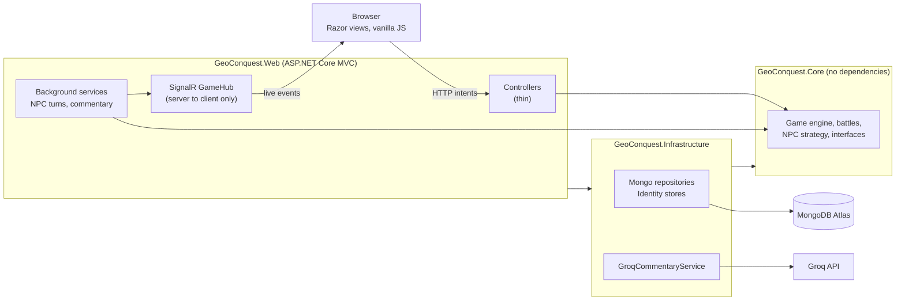
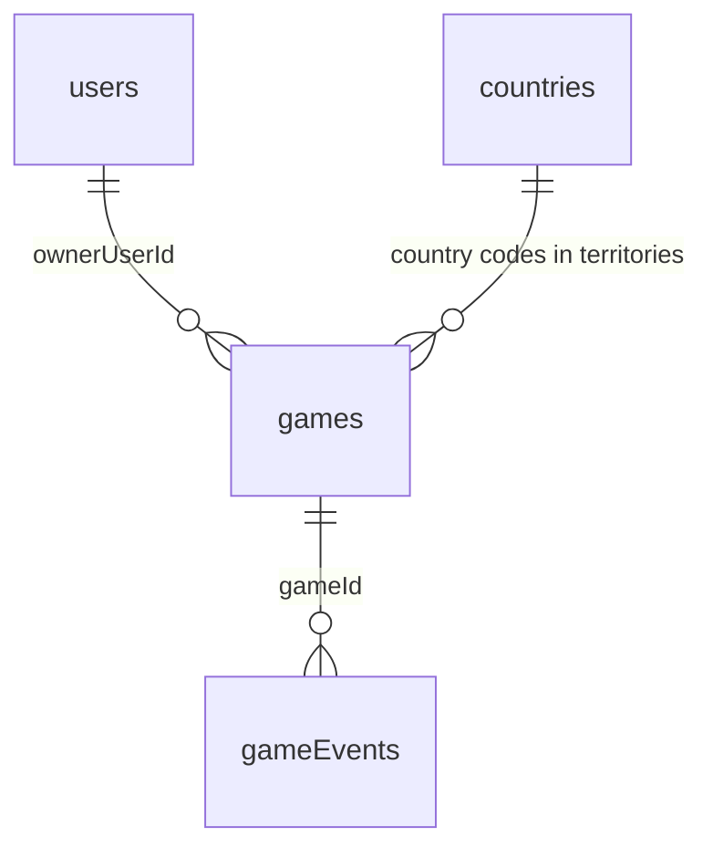

# GeoConquest

A single-player, Risk-style geopolitics game for the browser, submitted for the University of Cape Town
INF4001N Honours Entrance Examination for 2027.

[](https://github.com/pfunzom61-cmd/GeoConquest/actions/workflows/ci.yml)

**Deployed application:** https://geoconquest.onrender.com
**Demo video:** https://youtu.be/r2sBqL3AHdM

---

## Table of contents

1. [Overview](#1-overview)
2. [Quick start for markers](#2-quick-start-for-markers)
   - [2.1 The deployed application](#21-the-deployed-application)
   - [2.2 Running the application locally](#22-running-the-application-locally)
   - [2.3 A ten-minute guided tour](#23-a-ten-minute-guided-tour)
3. [Screenshots](#3-screenshots)
4. [Guide for markers: the rubric map](#4-guide-for-markers-the-rubric-map)
5. [Compliance with the brief](#5-compliance-with-the-brief)
6. [Repository layout](#6-repository-layout)
7. [Architecture](#7-architecture)
8. [Database design](#8-database-design)
9. [Game rules and my interpretations](#9-game-rules-and-my-interpretations)
10. [Use of artificial intelligence](#10-use-of-artificial-intelligence)
11. [Security](#11-security)
12. [Testing and continuous integration](#12-testing-and-continuous-integration)
13. [Bonus feature](#13-bonus-feature)
14. [Deployment](#14-deployment)
15. [Known limitations](#15-known-limitations)
16. [Credits and licences](#16-credits-and-licences)

---

## 1. Overview

GeoConquest implements the geopolitics case study set out in the entrance examination brief. A player selects a
country from a list of the world's nations; nine further countries are then drawn at random and played by
non-player characters. Each country is garrisoned according to its population, following the tier table in the
brief. Play proceeds in rounds of reinforcement, troop movement and dice-based attack until one player holds all
ten countries.

Three design positions shaped the implementation. The first is that the server is authoritative: the browser
submits intentions ("attack Brazil from Chile") and nothing more, while every die roll, every rule check and every
state transition occurs on the server. The second is that the game must survive interruption, so each step of a
non-player character's turn is persisted individually and play resumes after a restart. The third is that a game
should be watchable by anyone holding its link, without an account, which is the bonus feature claimed under
section 13.

| | |
|---|---|
| Platform | ASP.NET Core MVC on .NET 10, Razor views, vanilla JavaScript modules |
| Database | MongoDB Atlas (document database, free M0 tier) |
| Real-time transport | SignalR, with automatic fall-back to polling |
| Language model | Groq chat completions API, model `openai/gpt-oss-20b` |
| Hosting | Render, single Docker container |
| Automated tests | 300, run on every push by GitHub Actions |
| Bonus feature | #10, real-time viewing from a shared game link |

---

## 2. Quick start for markers

### 2.1 The deployed application

| | |
|---|---|
| Address | https://geoconquest.onrender.com |
| Demo account | `Tom@gmail.com` |
| Password | `Tom12345` |

The demo account is a throwaway created for marking; it holds a campaign already in progress. The first request
after a quiet period takes roughly a minute while the free host wakes the container, which is a characteristic of
the free tier rather than of the application.

One point of play is worth knowing in advance. The non-player characters attack hard and do not play at random, so
a campaign begun from a small country can be lost within a few rounds. Starting with a populous country such as
India or China gives a larger garrison and a longer game.

### 2.2 Running the application locally

The .NET 10 SDK and a MongoDB Atlas cluster are required; the free M0 tier is sufficient.

```
dotnet user-secrets set "MongoDb:ConnectionString" "<your Atlas connection string>" --project src/GeoConquest.Web
dotnet user-secrets set "Groq:ApiKey" "<optional Groq API key>" --project src/GeoConquest.Web
dotnet run --project src/GeoConquest.Web
```

Open the address printed in the console. The Groq key is optional: without it, battle commentary is produced by the
template service instead of the language model, and the application is otherwise unaffected. On first start the
application creates its indexes and loads 234 countries from
[countries.json](src/GeoConquest.Infrastructure/Seed/countries.json).

To inspect the code rather than the running application, `dotnet build` and `dotnet test` are sufficient; no
database or network access is needed for the test suite.

### 2.3 A ten-minute guided tour

The following sequence exercises every criterion on the marksheet in roughly ten minutes.

| Step | What to do | What it demonstrates |
|---|---|---|
| 1 | Open the deployed address while signed out and follow **Live games** | Public access control; list with search, status filter and sort |
| 2 | Open any listed game | Spectator view: full board, read-only, no orders panel |
| 3 | Register a new account with a weak password, then a valid one | Validation; password policy; field-level error messages |
| 4 | **New campaign**, search the country list, choose a large country | Searching and filtering; soldier allocation by population |
| 5 | Place reinforcements, then attack a neighbour | Turn state machine; dice pairing; server-side rule enforcement |
| 6 | Watch the dice, the commentary strip and the event log | Battle visualisation; language-model commentary; event history |
| 7 | Filter the event log by **NPC decisions** | Non-player character reasoning, with a justification for each move |
| 8 | End the turn, then press **Fast-forward NPC turns** | Accelerated simulation with every move still shown |
| 9 | Press **Copy game link**, open it in a private window, and play a move | Bonus feature: real-time spectating from a shared link |
| 10 | Visit **My campaigns**, then **Profile**, then `/how-to-play` | Per-user lists; navigation; in-application rules |
| 11 | Request a nonexistent address such as `/no-such-page` | Friendly error pages rather than framework defaults |
| 12 | Request `/health` | Live database connectivity check |

---

## 3. Screenshots

| | |
|---|---|
| Landing page ||
| Board on a desktop (1) ||
| Board on a desktop (2) ||
| A spectator's view | |


---

## 4. Guide for markers: the rubric map

Each row of the marksheet, with the files that implement it and the tests that prove it. Paths are given from the
repository root.

| # | Marking criterion | Where to look | Tests |
|---|---|---|---|
| 1 | Database layer | `src/GeoConquest.Infrastructure/` is a separate project holding all MongoDB code: `src/GeoConquest.Infrastructure/Repositories/`, `src/GeoConquest.Infrastructure/Data/MongoContext.cs`, `src/GeoConquest.Infrastructure/Configuration/MongoDbOptions.cs`. Core sees only interfaces such as `src/GeoConquest.Core/Interfaces/IGameRepository.cs`. | `tests/GeoConquest.Infrastructure.Tests/Data/MongoMappingTests.cs`, `tests/GeoConquest.Infrastructure.Tests/Seed/CountrySeederTests.cs` |
| 2 | Connection to the database | A single `IMongoClient` registered once in `src/GeoConquest.Infrastructure/DependencyInjection.cs`; the connection string is validated at start-up from user-secrets or environment variables; `/health` pings the database through `src/GeoConquest.Infrastructure/Data/MongoHealthCheck.cs`, mapped in `src/GeoConquest.Web/Program.cs`. | `tests/GeoConquest.Web.Tests/HealthEndpointTests.cs` |
| 3 | Design of the database | Collections, indexes and class mapping: `src/GeoConquest.Infrastructure/Data/MongoContext.cs`, `src/GeoConquest.Infrastructure/Data/Mapping/MongoMappingConfiguration.cs`, `src/GeoConquest.Core/Models/Game.cs`. Discussed in [section 8](#8-database-design). | `tests/GeoConquest.Infrastructure.Tests/Data/MongoMappingTests.cs` |
| 4 | Coding structure | Three projects and three test projects, described in [section 6](#6-repository-layout) and [section 7](#7-architecture). Services are registered through extension methods in `src/GeoConquest.Web/Extensions/`; settings are `IOptions` classes; controllers in `src/GeoConquest.Web/Controllers/` are thin. Conventions are enforced by `.editorconfig` and `Directory.Build.props`. | `tests/GeoConquest.Web.Tests/Fakes/GeoConquestWebFactory.cs` (every web test starts the real application and its dependency-injection container against in-memory repositories) |
| 5 | Object-oriented concepts | Models protect their own invariants: `src/GeoConquest.Core/Models/Territory.cs`, `src/GeoConquest.Core/Models/Game.cs`. Interfaces with several implementations: `src/GeoConquest.Core/Interfaces/ICommentaryService.cs` (template, Groq and a resilient decorator), `src/GeoConquest.Core/Interfaces/INpcStrategy.cs`, `src/GeoConquest.Core/Interfaces/IDiceRoller.cs`. Rule breaches raise `src/GeoConquest.Core/Exceptions/GameRuleException.cs`. | `tests/GeoConquest.Core.Tests/Models/TerritoryTests.cs`, `tests/GeoConquest.Core.Tests/Models/GameTests.cs` |
| 6 | Data validation, controls and security | View-model validation: `src/GeoConquest.Web/ViewModels/RegisterViewModel.cs`, `src/GeoConquest.Web/ViewModels/AttackRequest.cs`. Domain guards: `src/GeoConquest.Core/Services/GameEngine.cs`. Error mapping: `src/GeoConquest.Web/Filters/GameErrorFilterAttribute.cs`. Anti-forgery and rate limiting: `src/GeoConquest.Web/Extensions/SecurityServiceCollectionExtensions.cs`. Dice: `src/GeoConquest.Core/Services/SecureDiceRoller.cs`. Discussed in [section 11](#11-security). | `tests/GeoConquest.Web.Tests/AccountTests.cs` (password policy, anti-forgery, throttling), `tests/GeoConquest.Core.Tests/Services/GameEngineTests.cs` (rule guards), `tests/GeoConquest.Web.Tests/LiveUpdatesTests.cs` (no `innerHTML`) |
| 7 | Functionality | `src/GeoConquest.Core/Services/GameEngine.cs` (turn state machine), together with `BattleService.cs`, `ReinforcementService.cs`, `GameSetupService.cs` and `SoldierAllocator.cs` in `src/GeoConquest.Core/Services/`. | `tests/GeoConquest.Core.Tests/Services/GameEngineTests.cs`, `BattleServiceTests.cs`, `ReinforcementServiceTests.cs`, `GameSetupServiceTests.cs`, `SoldierAllocatorTests.cs` (same folder) |
| 8 | Lists, searching, filtering and viewing | My campaigns, with search, status filter and sort: `src/GeoConquest.Web/Views/Games/Index.cshtml`. Live games, with search, status filter and sort: `src/GeoConquest.Web/Views/LiveGames/Index.cshtml`. Country picker with search: `src/GeoConquest.Web/Views/Games/New.cshtml`. Event log filter (all, battles, NPC decisions, commentary): `src/GeoConquest.Web/Views/Games/_EventLog.cshtml`. Query logic: `src/GeoConquest.Core/Services/GameQueryService.cs`. | `tests/GeoConquest.Core.Tests/Services/GameApplicationServiceTests.cs`, `tests/GeoConquest.Web.Tests/GamesTests.cs` |
| 9 | User interface | Hand-written CSS organised around design tokens: `src/GeoConquest.Web/wwwroot/css/tokens.css`, `src/GeoConquest.Web/wwwroot/css/components/`, `src/GeoConquest.Web/wwwroot/css/pages/`. Self-hosted fonts: `src/GeoConquest.Web/wwwroot/fonts/`. Board markup and behaviour: `src/GeoConquest.Web/Views/Games/Play.cshtml` and `src/GeoConquest.Web/wwwroot/js/board.js`. No front-end framework and no default Bootstrap styling is used. | `tests/GeoConquest.Web.Tests/PageShellTests.cs` |
| 10 | Ease of navigation | Layout and primary navigation: `src/GeoConquest.Web/Views/Shared/_Layout.cshtml`. Breadcrumb on the game page: `src/GeoConquest.Web/Views/Shared/_Breadcrumb.cshtml`. Turn banner and reasons given on disabled controls: `src/GeoConquest.Web/Views/Games/_TurnBanner.cshtml`, `src/GeoConquest.Web/Views/Games/_OrdersPanel.cshtml`. Empty states and status pages: `src/GeoConquest.Web/Views/Shared/_EmptyState.cshtml`, `src/GeoConquest.Web/Views/Shared/StatusPage.cshtml`. In-application rules: `src/GeoConquest.Web/Views/Home/HowToPlay.cshtml`. | `tests/GeoConquest.Web.Tests/PageShellTests.cs` |
| 11 | Authentication and authorisation | ASP.NET Core Identity backed by MongoDB: `src/GeoConquest.Web/Extensions/IdentityServiceCollectionExtensions.cs`, `src/GeoConquest.Infrastructure/Identity/`. Resource-based authorisation restricting play to the owner: `src/GeoConquest.Web/Authorization/GameOwnerHandler.cs`, `src/GeoConquest.Web/Authorization/GamePolicies.cs`. | `tests/GeoConquest.Web.Tests/AccountTests.cs` (registration, sign-in, lockout), `tests/GeoConquest.Web.Tests/GamesTests.cs` (another user receives 403; an anonymous request receives 401) |
| 12 | Sophistication and complexity | Exact attack win probability by dynamic programming: `src/GeoConquest.Core/Services/BattleOddsCalculator.cs`. Non-player character decisions with stated reasons: `src/GeoConquest.Core/Services/StrategicNpcStrategy.cs`. Resumable background execution of NPC turns: `src/GeoConquest.Core/Services/NpcTurnProcessor.cs`, `src/GeoConquest.Web/BackgroundServices/`. Real-time updates: `src/GeoConquest.Web/Hubs/GameHub.cs`. | `tests/GeoConquest.Core.Tests/Services/BattleOddsCalculatorTests.cs`, `NpcSimulationTests.cs`, `NpcTurnProcessorTests.cs` (same folder), `tests/GeoConquest.Web.Tests/LiveUpdatesTests.cs` |
| 13 | AI application | Prompt construction, output guard, fallback and rate limiting: `src/GeoConquest.Core/Services/CommentaryPromptBuilder.cs`, `CommentaryOutputGuard.cs`, `ResilientCommentaryService.cs`, `TemplateCommentaryService.cs`, `CommentaryRateLimiter.cs` (same folder). Groq client: `src/GeoConquest.Infrastructure/AI/GroqCommentaryService.cs`. Computed win probabilities behind NPC reasoning: `src/GeoConquest.Core/Services/StrategicNpcStrategy.cs`. Discussed in [section 10](#10-use-of-artificial-intelligence). | `tests/GeoConquest.Core.Tests/Services/CommentaryOutputGuardTests.cs`, `CommentaryPromptBuilderTests.cs`, `ResilientCommentaryServiceTests.cs` (same folder), `tests/GeoConquest.Infrastructure.Tests/AI/GroqCommentaryServiceTests.cs` |
| 14 | Overall evidence of effort | The commit history; continuous integration in `.github/workflows/ci.yml`; 300 automated tests; this document, with diagrams and screenshots in `docs/screenshots/`; and the bonus feature described in [section 13](#13-bonus-feature). | `dotnet test` |

---

## 5. Compliance with the brief

Every rule in the brief, grouped by topic, with its implementation and the tests that cover it. Paths are given from
`src/GeoConquest.Core/` unless stated otherwise. Matters that exist only in the browser — the appearance of the
board, the dice and stamp animations, the feel of live updates — have no automated tests and were verified by hand;
these are marked accordingly.

| Topic | Rules in the brief | Implemented in | Tests |
|---|---|---|---|
| Setup | Ten countries; the player chooses one from the world list; nine others drawn at random; soldiers allocated by population tier; the player begins with the full soldier value; the first player is chosen at random; a user may hold several games | `Services/GameSetupService.cs`, `Services/SoldierAllocator.cs`, `Services/SecureShuffler.cs`; picker in `src/GeoConquest.Web/Views/Games/New.cshtml` (search verified by hand); seed data in `src/GeoConquest.Infrastructure/Seed/` | `GameSetupServiceTests`, `SoldierAllocatorTests` (every tier boundary), `CountrySeedMapperTests`, `GamesTests` |
| Turns | One attack per turn, or skip; skipping passes play on; transfers only between the player's own countries and only outside an attack; every country retains at least one soldier | `Services/GameEngine.cs` (`Skip`, `Transfer`, `StartAttack`), `Models/Game.cs`, `Models/Territory.cs` | `GameEngineTests` (one per rule), `TerritoryTests`, `GamesTests.Transfer_BreakingARule_IsRejectedWithTheReason` |
| Fast-forward | Accelerates NPC moves until the player's next turn; every move is still displayed | `Models/Game.cs` (`SetFastForward`, `StartTurn`), `Services/NpcTurnProcessor.cs`, `NpcPacing`; control in `src/GeoConquest.Web/Views/Games/_OrdersPanel.cshtml` (on-screen pace verified by hand) | `NpcTurnProcessorTests.PlayUntilHumanTurnAsync_FastForward_ChangesOnlyTheWaitBetweenSteps`, `GameTests`, `GameSyncTests.FastForward_OnlyTheOwnerMayChangeThePace` |
| Attacks and dice | A target is chosen; two or more soldiers are needed to attack or to continue; rolling continues until the defender is conquered, the attacker is reduced to one soldier, or the attacker stops; the number of dice is the lesser of the attacker's soldiers minus one and the defender's soldiers; dice are paired in the order rolled; the higher die wins and a tie costs nothing; a failed attacker retains its country | `Services/BattleService.cs`, `Services/GameEngine.cs` (`RollAttack`, `StopAttack`), `Services/SecureDiceRoller.cs` | `BattleServiceTests` (the three dice examples and the worked example given in the brief), `GameEngineTests`, `SecureDiceRollerTests` |
| Conquest | The conqueror gains Max(2, soldier value ÷ 2); may then move further soldiers in; may attack from the new country on a later turn | `Services/BattleService.cs`, `Services/GameEngine.cs` | `BattleServiceTests.RollRound_ConqueringCountry_RewardIsHalfItsSoldierValueWithMinimumTwo` (India, value 9, yields 4; Vatican City, value 1, yields 2), `GameEngineTests.StartAttack_FromCountryConqueredThisTurn_ThrowsButSucceedsNextTurn` |
| Receiving soldiers | Round one ends once every player has taken a turn; from round two, two soldiers per country held are granted at the start of a turn, with a minimum of two, allocated freely | `Services/ReinforcementService.cs`, `Models/Game.cs` | `ReinforcementServiceTests` (one, three and five countries), `GameEngineTests`, `GameTests` |
| Elimination and victory | A player holding no country is eliminated, receives no further soldiers and is skipped; holding all ten countries wins | `Services/GameEngine.cs` (`RollAttack`), `Models/Game.cs` | `GameEngineTests` (eliminated, won, lost), `GameTests.AdvanceToNextLivingPlayer_*` |
| Visibility and battles | All countries and soldier counts visible at all times; any country may attack any other; each attack, roll, loss and outcome shown as it happens; commentary generated by a language model | `src/GeoConquest.Web/ViewModels/GameStateViewModel.cs`, `src/GeoConquest.Web/Hubs/GameHub.cs`, `src/GeoConquest.Web/wwwroot/js/board-*.js` (appearance verified by hand); commentary in `Services/ResilientCommentaryService.cs` and `src/GeoConquest.Infrastructure/AI/GroqCommentaryService.cs` | `GameSyncTests.Sync_AnonymousSpectator_SeesAllTenCountriesWithTheirSoldierCounts`, `GameEngineTests.RollAttack_AnyRound_RecordsTheFactsCommentaryIsWrittenFrom`, `LiveUpdatesTests`, `GroqCommentaryServiceTests`, `ResilientCommentaryServiceTests`, `CommentaryPromptBuilderTests`, `CommentaryOutputGuardTests` |
| NPC behaviour | Plays to win rather than at random; decides whether to attack, whom to target and when to stop; allocates reinforcements; may transfer soldiers; every decision shown with a brief justification, including during fast-forward | `Services/StrategicNpcStrategy.cs`, `Services/NpcTurnExecutor.cs`, `Services/BattleOddsCalculator.cs` | `StrategicNpcStrategyTests`, `NpcTurnExecutorTests`, `NpcSimulationTests` (a complete game in which every decision carries a justification), `BattleOddsCalculatorTests` |
| Access control | Anyone holding the link may watch; only the signed-in owner may play; any visitor may register and begin a game | `src/GeoConquest.Web/Authorization/`, `src/GeoConquest.Web/Controllers/GameActionsController.cs`, `src/GeoConquest.Web/Controllers/AccountController.cs` | `GamesTests` (spectator; anonymous receives 401; another user receives 403), `AccountTests`, `LiveUpdatesTests.Hub_ClientInvokesAServerMethod_IsRefused` |
| Technical requirements | A web application; a NoSQL database; deployed to a server | ASP.NET Core MVC; MongoDB Atlas; Render (see [section 14](#14-deployment)) | `MongoMappingTests`, `HealthEndpointTests`; every web test starts the real application |
| Bonus | One additional feature | Feature #10, real-time viewing from a shared game link (see [section 13](#13-bonus-feature)) | `LiveUpdatesTests`, `GameSyncTests` |
| Submission | Zipped source, database access for the examiners, deployed link, application credentials, this read-me | [Section 2](#2-quick-start-for-markers) and the accompanying hand-in note | Not applicable |

---

## 6. Repository layout

```
GeoConquest.sln
├── src/
│   ├── GeoConquest.Core/             Domain model and game rules. No external dependencies.
│   │   ├── Models/                   Game, Player, Territory, BattleContext
│   │   ├── Enums/                    TurnPhase, GameStatus, event kinds, list filters
│   │   ├── Exceptions/               GameRuleException, ConcurrencyException
│   │   ├── Interfaces/               IGameRepository, ICommentaryService, INpcStrategy, IDiceRoller
│   │   ├── Services/                 GameEngine, BattleService, ReinforcementService,
│   │   │                             GameSetupService, SoldierAllocator, StrategicNpcStrategy,
│   │   │                             BattleOddsCalculator, NpcTurnProcessor, commentary services
│   │   └── Constants/
│   ├── GeoConquest.Infrastructure/   Everything external to the domain.
│   │   ├── Data/                     MongoContext, health check, class mapping
│   │   ├── Repositories/             MongoGameRepository, MongoGameEventRepository
│   │   ├── Identity/                 Identity stores backed by MongoDB
│   │   ├── AI/                       GroqCommentaryService
│   │   ├── Seed/                     countries.json and the seeder
│   │   └── Configuration/            Options classes
│   └── GeoConquest.Web/              ASP.NET Core MVC presentation layer.
│       ├── Controllers/              Thin; orchestration only
│       ├── ViewModels/               Request validation and view shaping
│       ├── Views/                    Razor views and partials
│       ├── Hubs/                     GameHub (server to client only)
│       ├── BackgroundServices/       NPC turn runner, commentary scheduler
│       ├── Authorization/            GamePolicies, GameOwnerHandler
│       ├── Filters/                  GameErrorFilterAttribute
│       ├── Extensions/               Dependency-injection registration
│       └── wwwroot/                  CSS, JavaScript modules, self-hosted fonts
├── tests/
│   ├── GeoConquest.Core.Tests/            224 tests: rules, battles, odds, NPC play, commentary
│   ├── GeoConquest.Infrastructure.Tests/   28 tests: mapping, seed data, Groq client against a fake
│   └── GeoConquest.Web.Tests/              48 tests: sign-in, authorisation, validation, live updates
├── docs/screenshots/
├── .github/workflows/ci.yml
└── Dockerfile
```

Each public type occupies a file named after it, and each folder corresponds to a role rather than to a feature.
Interfaces are declared in `Core/Interfaces`, while implementations live beside their dependencies: repositories in
Infrastructure, rules in Core.

---

## 7. Architecture



Dependencies point in one direction only: Web depends on Infrastructure, and both depend on Core. Core holds the
rules and the interfaces (`IGameRepository`, `ICommentaryService`, `IDiceRoller` and the rest) and knows nothing of
MongoDB, HTTP or Groq. The practical consequence is that the entire rule set can be tested without a database, a
web server or a network connection, which is why the Core test project is the largest of the three.

The browser submits intentions only. The server rolls the dice, evaluates every rule and persists the result. A
background service plays non-player character turns one step at a time, saving after each step, so that a restart
resumes play rather than abandoning it. Once a save succeeds, the new events are pushed over SignalR to everyone
watching that game.

---

## 8. Database design

A document database suits this problem because a game is a single self-contained aggregate — players, territories
and the battle in progress — that is always loaded and saved as a whole, while its history is a separate
append-only sequence. Modelling the same structure relationally would require several joins to reconstitute a
board that is never needed in parts.

| Collection | Contents | Key fields and indexes |
|---|---|---|
| `users` | Identity accounts | Unique index on `normalizedEmail` |
| `countries` | 234 seeded countries with populations | `_id` is the ISO code, so uniqueness needs no further index |
| `games` | One document per campaign: players, territories, turn, phase, active battle, status | `version`; index on `ownerUserId` + `status` (my campaigns); index on `status` + `updatedAt` (live games) |
| `gameEvents` | Append-only record of every move, NPC decision and commentary line | Unique index on `gameId` + `sequence` |
| `dataProtectionKeys` | Cookie and anti-forgery keys, so that sign-ins survive a restart | None |



**Optimistic concurrency.** `Game.Version` is checked on every save. The update matches only if the stored version
is the one that was loaded, and it writes `version + 1` in the same operation. A stale save is rejected with a
`ConcurrencyException`, surfaced to the browser as 409 and handled by the NPC runner as a retry. This is what
prevents a player's click and a background NPC step from overwriting one another.

**Event sequence.** Events are numbered per game, and the unique index on `gameId` + `sequence` makes appending
idempotent, so that a retry after a failure cannot produce duplicates. Each dice roll also reserves a number for
its commentary, which is written later without a second save of the game; sequence numbers are therefore not always
contiguous at the moment of reading.

An abbreviated `games` document, with illustrative values:

```json
{
  "_id": "…", "ownerUserId": "…", "ownerDisplayName": "Sam", "status": "InProgress",
  "roundNumber": 3, "currentTurnIndex": 0, "phase": "Action", "pendingReinforcements": 0,
  "activeBattle": null, "isFastForward": false, "lastEventSequence": 118, "version": 57,
  "players": [ { "id": "human", "homeCountryCode": "BR" }, { "id": "npc-JP", "homeCountryCode": "JP" } ],
  "territories": [ { "countryCode": "BR", "ownerPlayerId": "human", "soldiers": 4, "soldierValue": 3 } ]
}
```

Identity's role store is configured but unused. Authorisation here is a property of the game rather than of the
account: the owner may act, and everyone else may watch. A role column would add an indirection without expressing
anything the per-game policy does not already express.

---

## 9. Game rules and my interpretations

The brief leaves certain details open. The following are the readings I adopted; the tests and the in-application
rules page at `/how-to-play` follow them consistently.

1. **Tier boundaries are inclusive.** A population of exactly 5,000,000 is worth one soldier.
2. **Soldier value is fixed.** It is derived from population at setup and never changes thereafter. The number of
   soldiers a country currently holds is a separate quantity.
3. **Dice are not capped at three.** Each side rolls as many dice as the lesser of the attacker's soldiers minus
   one and the defender's soldiers, and the dice are compared in the order rolled rather than sorted. This follows
   the worked example given in the brief, which pairs Die 1 against Die 1 and Die 2 against Die 2.
4. **After a conquest** the reward — half the country's soldier value, with a minimum of two — becomes the new
   garrison, and the conqueror may then move further soldiers in from the attacking country. The attacking country
   always retains at least one soldier.
5. **A turn** consists of placing reinforcements (from round two), optional movements, at most one attack, optional
   movements once the attack has ended, and then ending the turn. Stopping an attack ends the turn immediately, as
   the brief specifies.
6. **The player's own country is not among the nine.** The nine opponents are drawn from the remaining countries,
   one non-player character to each.
7. **Victory and defeat.** The player wins on holding all ten countries, and loses on elimination or when a
   non-player character holds all ten.
8. **Population figures** are a snapshot taken from Worldometers on 30 October 2026, stored together with their
   source and date in `countries.json`.
9. **Spectators** see the same board, battles, commentary and NPC explanations as the owner, at the same time.
10. **Fast-forward** shortens the pause between NPC steps and never omits an event. It belongs to the owner, it
    switches itself off when the owner's next turn begins, and it cannot be engaged in a finished game.
11. **No non-player character attacks the player in round one.** The brief does not prescribe how a non-player
    character selects its target. In simulation, without this restriction the player was frequently eliminated
    before taking a first turn, which made the game unplayable rather than difficult. From round two the player is
    an ordinary target.

---

## 10. Use of artificial intelligence

### Battle commentary

Each round of dice receives one or two sentences of commentary from a language model, served by Groq's
OpenAI-compatible chat completions API using `openai/gpt-oss-20b` by default. Four constraints shaped the design.

The prompt is assembled from facts alone. `CommentaryPromptBuilder` renders `BattleContext` as plain sentences —
who rolled what, who lost a soldier, who is ahead in the exchange — and explicitly asks for no numerals in the
reply, because early testing showed the model conflating die values with dice counts. Player names are excluded, so
no text a user has typed is ever sent to the model.

Commentary never delays play. A roll is saved and returned immediately, and the commentary is produced by a
background worker within a budget of 2.5 seconds. It is written into a log position reserved at the time of the
roll, so it requires no second save of the game, cannot conflict with the next move, and appears in the correct
order however late it arrives.

The feature degrades rather than fails. `ResilientCommentaryService` falls back to `TemplateCommentaryService` on
timeout, on HTTP 429, on any error and when no key is configured. It observes a limit of ten requests per minute
and honours `retry-after`. Fast-forwarded NPC rolls use the template directly and spend no request at all.

Model output is treated as untrusted. `CommentaryOutputGuard` truncates to two whole sentences and 240 characters
and rejects anything empty, off-topic, containing a digit or a number word, or unsuitable for a general audience.
The board inserts the result as text, never as markup. Every line is persisted as a `Commentary` event and labelled
with its source, so that a reader can always tell whether the model or the template wrote it.

The key is supplied through `dotnet user-secrets` (`Groq:ApiKey`) locally or the `Groq__ApiKey` environment
variable in production. It is never logged: the HTTP client's request logging is removed and the service records
status codes only.

### Non-player character reasoning

The non-player characters do **not** use a language model. `StrategicNpcStrategy` scores each available option
using exact win probabilities computed by `BattleOddsCalculator`, a memoised dynamic program over the dice
distribution, and weights them by factors including the threat a neighbour poses, whether a target is the current
leader, and whether an attack would eliminate a player. Each decision is recorded with a one-line justification,
visible in the event log and during fast-forward. The choice was deliberate: a deterministic scorer is testable,
reproducible and fast, where a language model would be none of those things and would make the opponents' quality
depend on an external service.

### Artificial intelligence during development

An AI coding assistant was used while building this project, for writing and reviewing code, tests and
documentation. I set the architecture, made the design decisions recorded in this document, reviewed the output and
ran the results.

---

## 11. Security

**Accounts.** ASP.NET Core Identity, stored in MongoDB. Passwords require at least eight characters including an
upper-case letter, a lower-case letter and a digit. Five failed attempts lock an account for fifteen minutes. An
unknown email address and an incorrect password produce the same message, so that the form cannot be used to
enumerate accounts. The authentication cookie is HTTP-only and `SameSite=Lax`, and lasts seven days with sliding
renewal.

**Anti-forgery.** A token is required on every POST, applied globally rather than per action; the board sends it in
a request header.

**Authorisation.** A resource-based policy, `CanPlayGame`, permits only a game's owner to act upon it. Anonymous
requests receive 401, other authenticated users receive 403, and spectators are restricted to reading.

**Rate limiting.** Sign-in and registration are limited per address, at ten requests per minute by default.

**Server authority.** Dice are drawn from a cryptographic random source and every rule is evaluated on the server.
No value supplied by the client is trusted.

**No account details in public data.** Public pages, the live games list and every message pushed over SignalR
carry the owner's display name alone, never an email address or user identifier. The single exception is the
profile page, which shows signed-in users their own email address. The hub exposes no method a client can invoke.

**No HTML injection.** Scripts under `src/GeoConquest.Web/wwwroot/js/` never use `innerHTML`, `outerHTML`,
`insertAdjacentHTML` or `document.write`, and a test fails if any of them is introduced. All server text, including
model-generated commentary, is inserted as text nodes.

**Secrets.** The connection string and API key are supplied by user-secrets locally and environment variables in
production. Neither appears in the repository or its history.

**Transport.** The application does not itself redirect to HTTPS, because the host terminates TLS ahead of the
container; forwarded headers are configured accordingly.

---

## 12. Testing and continuous integration

The suite comprises 300 tests, all passing: 224 in `tests/GeoConquest.Core.Tests` covering rules, battles, odds,
non-player character play and commentary; 28 in `tests/GeoConquest.Infrastructure.Tests` covering document mapping,
seed data and the Groq client against a fake transport; and 48 in `tests/GeoConquest.Web.Tests` covering sign-in,
owner against spectator, validation, live updates and error pages.

Tests are written against the rules of the brief rather than against the shape of the code. The dice examples given
in the brief, including the worked ten-against-two example, appear verbatim as test cases, as do the tier
boundaries and the conquest reward for India and Vatican City. `NpcSimulationTests` plays a complete game and
asserts that every non-player character decision carries a justification.

No test contacts the real MongoDB or Groq. Randomness is abstracted behind `IDiceRoller` and time behind
`TimeProvider`, so that tests inject fixed dice and fixed clocks and are deterministic. Web tests start the real
application through `WebApplicationFactory` with in-memory repositories, which means the dependency-injection
configuration, routing, filters and authorisation policies are all exercised rather than mocked away.

```
dotnet test
```

The workflow in [.github/workflows/ci.yml](.github/workflows/ci.yml) restores, builds in Release configuration and
runs the full suite on every push and pull request, publishing a test summary. The board page was additionally
measured with Lighthouse, scoring 100 for accessibility in both the owner and the spectator view.

---

## 13. Bonus feature

The brief permits one additional feature. The feature claimed is **#10, a shared game URL that allows viewing in
real time**.

Anyone holding a game's address (`/games/<id>`) may watch it as it happens, without an account. Moves, dice rolls,
non-player character explanations and commentary appear as they occur, delivered over SignalR with an automatic
fall-back to polling where live connections are blocked. Spectators receive a read-only board with no orders panel,
and the view models sent to them carry no user identifiers or email addresses.

To observe it: sign in, begin a campaign, press **Copy game link**, and open the link in a private window or in a
browser where you are not signed in. A move played in the first window appears in the second without a refresh. The
**Live games** page lists games in progress by default and can also show finished games; any of them may be opened
to spectate.

The animations (the tumbling dice, the ticking counters, the conquest stamp) are presentation rather than a
feature, and the win-probability figure shown to the owner during an attack is a play aid drawn from the same
calculator the non-player characters use. Neither is claimed as the bonus.

---

## 14. Deployment

The application runs as a single Docker container built from the [Dockerfile](Dockerfile), which publishes
`src/GeoConquest.Web`. It listens on the `PORT` environment variable, which the host supplies; the default is 8080.

Environment variables are given by name only. Values belong in the host's dashboard and never in the repository.

| Variable | Required | Purpose |
|---|---|---|
| `MongoDb__ConnectionString` | Yes | MongoDB Atlas connection string. The application refuses to start without it. |
| `MongoDb__DatabaseName` | No | Database name; defaults to `geoconquest`. |
| `ASPNETCORE_ENVIRONMENT` | No | Set to `Production` on the host. |
| `Groq__ApiKey` | No | Enables model-generated commentary. Without it, every line comes from the template service. |
| `Groq__Model` | No | Groq model name; defaults to `openai/gpt-oss-20b`. |

`PORT` is set by the host and is not configured. `ForwardedHeaders__ForwardLimit` is needed only if distinct
visitors are observed to share a single rate-limit bucket, in which case it is raised from 1 to 2.

**Host configuration.** A Render Web Service on the free instance type, Docker runtime, health check path `/health`,
with automatic deployment from the deployment branch. In Atlas, Network Access must admit the host's addresses;
the free tier has no fixed outbound addresses, so `0.0.0.0/0` is required.

**A single instance only.** SignalR groups are held in process memory and the non-player character runner lives
inside the web process, so a second instance would divide the viewers of a game between them and could play the
same NPC turn twice. Scaling out would require a SignalR backplane and a distributed lock on the turn runner;
neither is warranted at this scale.

---

## 15. Known limitations

These are stated plainly rather than omitted, since each was a deliberate trade-off.

- **One instance only.** Live updates and the NPC runner are held in memory in a single process, as explained in
  section 14.
- **Free-tier sleep.** The hosted application sleeps after fifteen minutes without traffic and takes about a minute
  to wake. Non-player characters do not play while it sleeps.
- **The opponents are aggressive.** From a small starting country a player may be eliminated within a few rounds.
  A populous country is the safer opening.
- **Commentary quota.** The free Groq tier permits only a few requests per minute, so a busy run of non-player
  character turns will often show template commentary. Each line is labelled with its source, so the distinction is
  always visible.
- **No automated browser tests.** The appearance of the board, its animations and the feel of live updates were
  verified by hand rather than by an automated harness.
- **Lists are not paged.** The live games page considers the fifty most recently updated games for the chosen
  status, so its search and round sort operate within those fifty.
- **A fresh clone needs its own database.** The application ships no demo data; the demo account named in section 2
  was created on the hosted site.

---

## 16. Credits and licences

- **Fonts.** Stardos Stencil, Libre Franklin and Courier Prime are self-hosted under the SIL Open Font License 1.1.
  See [src/GeoConquest.Web/wwwroot/fonts/LICENSE.txt](src/GeoConquest.Web/wwwroot/fonts/LICENSE.txt).
- **Flag images** are loaded directly from [flagcdn.com](https://flagcdn.com), a service of
  [Flagpedia.net](https://flagpedia.net), which describes them as public domain and free for commercial and
  non-commercial use, and requests a link in return. They are hotlinked rather than copied into the repository, so
  flags require an internet connection; the two-letter country code is shown in their absence.
- **SignalR browser client** (`@microsoft/signalr`, MIT licence) is vendored in
  [src/GeoConquest.Web/wwwroot/lib/signalr](src/GeoConquest.Web/wwwroot/lib/signalr/README.txt).
- **Population figures** are drawn from Worldometers, which bases them on the United Nations World Population
  Prospects, 2024 revision.
